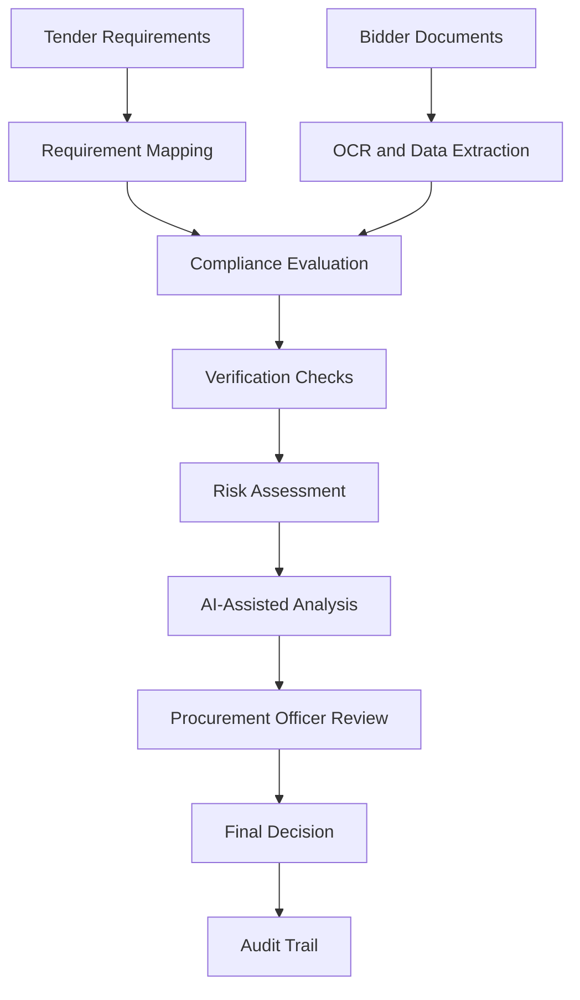

# INOTENDER

### AI-Powered Bid Compliance & Procurement Intelligence Platform

<p align="center">
  An intelligent procurement platform that transforms tender requirements and bidder documents into structured, explainable compliance assessments.
</p>

<p align="center">
  <strong>React · TypeScript · FastAPI · PaddleOCR · PostgreSQL · Groq AI · Docker</strong>
</p>

---

## Overview

**INOTENDER** is an AI-powered procurement intelligence platform designed to streamline bid compliance verification. It helps procurement teams evaluate bidder submissions against tender-specific eligibility requirements, identify missing documentation, highlight inconsistencies, and understand potential compliance risks.

Instead of relying entirely on repetitive manual document checks, INOTENDER combines OCR, structured validation rules, external verification workflows, and AI-assisted analysis in a unified workspace.

The platform supports both bidders and procurement officers, with a human-in-the-loop approach that keeps final procurement decisions under officer control.

## The Problem

Tender evaluation can involve large PDFs, complex eligibility conditions, multiple supporting documents, and strict compliance requirements.

Common challenges include:

- Time-consuming manual document verification.
- Missing or incomplete bidder documentation.
- Inconsistent information across submitted evidence.
- Difficulty tracking mandatory and optional requirements.
- Limited visibility into compliance risks and supporting evidence.
- Inconsistent evaluation records and auditability.

## The Solution

INOTENDER provides an integrated workflow for document intelligence, compliance evaluation, risk assessment, and procurement decision support.

### Key Features

**1. Tender Requirement Management**
- Structure tender-specific compliance requirements.
- Distinguish mandatory and optional conditions.
- Support threshold-based and document-based checks.

**2. AI-Powered Document Intelligence**
- Process bidder documents using OCR and document extraction.
- Convert extracted information into structured data.
- Associate evidence with relevant compliance requirements.

**3. Automated Compliance Evaluation**
- Evaluate bidder information against tender requirements.
- Classify findings as PASS, FAIL, or NEEDS REVIEW.
- Identify missing documents and potential mismatches.

**4. Verification and Risk Assessment**
- Organise verification checks and their results.
- Highlight compliance failures, warnings, and unresolved evidence.
- Generate compliance scores and risk assessments.

**5. AI-Assisted Explanations**
- Summarise important compliance findings.
- Explain missing evidence and potential risks.
- Provide recommendations to support officer review.

**6. Bidder and Officer Portals**
- Provide role-specific access to procurement workflows.
- Separate bidder submissions from officer evaluation.
- Support a structured review and decision process.

**7. Audit Trail and Decision Support**
- Record relevant verification and decision events.
- Preserve explanations and supporting evidence for review.
- Keep final qualification decisions with the authorised Procurement Officer.

## How It Works



## Technology Stack

| Layer | Technologies |
|---|---|
| Frontend | React 19, TypeScript, Vite 8 |
| Styling | Tailwind CSS 4 |
| Backend | Python 3.11, FastAPI, Uvicorn |
| Data Validation | Pydantic |
| ORM and Database | SQLAlchemy, PostgreSQL |
| OCR and Document Processing | PaddleOCR, PyMuPDF, OpenCV, Pillow |
| AI Integration | Groq API, GPT-OSS-20B |
| Background Processing | Celery, Redis |
| Object Storage | MinIO |
| Vector Database | Qdrant |
| Deployment and Services | Docker Compose |

## Architecture

INOTENDER follows a modular frontend/backend architecture.

- **Frontend:** Provides the bidder and procurement officer interfaces.
- **API layer:** Exposes endpoints for authentication, submissions, compliance evaluation, and review workflows.
- **Document processing:** Extracts structured information from uploaded documents.
- **Compliance engine:** Evaluates evidence against configured tender requirements.
- **Verification services:** Organise external and internal verification results.
- **Risk engine:** Consolidates findings into risk assessments.
- **AI analysis service:** Produces contextual explanations and recommendations.
- **Persistence layer:** Stores submissions, documents, requirements, results, assessments, and audit events.
- **Supporting infrastructure:** Uses Redis, MinIO, Qdrant, and background workers where configured.

## Getting Started

### Prerequisites

Install the following:

- Git
- Docker Desktop
- Node.js 20 or later
- npm

Python is useful for local backend development; the Docker environment uses Python 3.11.

### 1. Clone the repository

```bash
git clone https://github.com/HaRvEysPeCteR69/INOTENDER.git
cd INOTENDER
```

### 2. Configure environment variables

Review the provided environment template and create the development configuration expected by Docker Compose.

```bash
cp .env.example .env.dev
```

Configure the required database, storage, authentication, and AI provider settings. Use your own credentials and secrets.

**Never commit `.env.dev`, API keys, database passwords, or JWT secrets.**

### 3. Start the backend infrastructure

```bash
docker compose -f infra/docker-compose.dev.yml up --build -d
```

Check the running services:

```bash
docker compose -f infra/docker-compose.dev.yml ps
```

### 4. Start the frontend

Open another terminal:

```bash
cd frontend
npm install
npm run dev
```

Open the local URL printed by Vite in your terminal.

### 5. Verify the application

Check the backend health endpoint:

```bash
curl http://localhost:8000/health
```

The exact setup may require environment configuration or database migrations, depending on the repository state.

## Example Compliance Workflow

1. Select the appropriate portal and authenticate.
2. Open the procurement workspace.
3. Load a tender and its compliance requirements.
4. Associate a bidder submission with the tender.
5. Process the submitted documents.
6. Run compliance evaluation and verification checks.
7. Review missing evidence, failures, warnings, and risk indicators.
8. Inspect AI-generated explanations.
9. Record the Procurement Officer's final decision.
10. Review the associated audit history.

## Security and Responsible Use

INOTENDER is designed to support procurement professionals rather than replace their judgement.

- Protect credentials and API keys using environment configuration.
- Restrict access to authorised users and appropriate roles.
- Treat AI-generated findings as decision-support information.
- Validate critical compliance outcomes against source evidence.
- Require authorised human review for final procurement decisions.

External verification depends on the availability, permissions, and integration status of the relevant services. A verification result should not be treated as official confirmation unless supported by an authoritative source.

## Project Status

INOTENDER is an evolving engineering project with implemented authentication, document processing, compliance evaluation, risk assessment, and AI-assisted review capabilities.

Some external integrations and advanced workflows may require further development and validation before production use.

## Future Improvements

- Stronger cross-document consistency checks.
- Expanded government registry integrations.
- Interactive evidence viewer with source-level traceability.
- Bidder clarification and document resubmission workflows.
- Automatic re-verification after document updates.
- Side-by-side bidder comparison.
- Enhanced role-based access controls and audit reporting.
- Production deployment, monitoring, and automated testing.

## Contributing

Contributions, suggestions, and technical feedback are welcome. For substantial changes, open an issue first to discuss the proposed improvement.

## Disclaimer

INOTENDER is an independent software project for procurement compliance assistance and demonstration. It is not an official GeM product and does not independently certify bidder eligibility or replace applicable procurement rules.

## Author

**INOTENDER**  
AI-powered procurement compliance and decision support.
